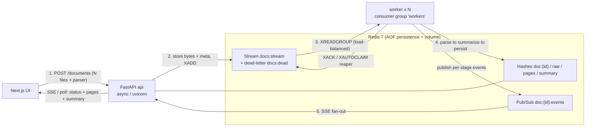

# Summer — Async PDF Processing

Upload one or more PDFs, pick a parser, and the backend asynchronously parses each file to
**per-page Markdown** and produces **one summary per file**. Results stream back to the UI in
real time.

- **Backend:** Python 3.12 · FastAPI (async) · Redis 7 **Streams** as the queue
- **Parsers:** PyPDF (text) · `gemini-3.1-flash-lite` (markdown) · `gpt-5-mini` (OCR)
- **AI provider:** [OpenRouter](https://openrouter.ai) — one OpenAI-compatible endpoint + one key for
  all models (parse, OCR, summary); deterministic mock fallback when no key is set
- **Frontend:** minimal Next.js (TypeScript), SSE with polling fallback
- **Infra:** Docker Compose (api · worker · redis · frontend)

Design notes live in [`docs/plan.md`](docs/plan.md) and
[`docs/adr/ADR-0001-upload-size-limit.md`](docs/adr/ADR-0001-upload-size-limit.md).

---

## Architecture



The **api** never does heavy work in the request — it validates, stores, and enqueues. **workers**
(scale with `--scale worker=N`) share one consumer group, so documents load-balance across them.

---

## Quick start

```bash
cp .env.example .env            # optional: add OPENROUTER_API_KEY for real mode
docker compose up --build
```

Run multiple workers for parallel processing:

```bash
docker compose up --build --scale worker=3
```

- API: <http://localhost:8000> (health at `/health`, OpenAPI docs at `/docs`)
- Frontend: <http://localhost:3000>

**Mock vs real mode:** with no key the app runs in deterministic **mock mode** (PyPDF text wrapped
as markdown + an extractive summary) so the whole pipeline and UI demo without credentials. Add a
single `OPENROUTER_API_KEY` to `.env` for real markdown parsing, OCR and summaries. Models are
configurable per role (`OPENROUTER_PARSE_MODEL`, `OPENROUTER_OCR_MODEL`, `OPENROUTER_SUMMARY_MODEL`);
defaults are `google/gemini-3.1-flash-lite` and `openai/gpt-5-mini`.

---

## API

Two ways to authenticate, both resolving to a **principal** (documents are owned per-principal and
reads are scoped accordingly):

- **Login (web UI):** `POST /auth/login` with `{username, password}` → returns a session `token`
  (stored in Redis with a TTL). Send it as `X-API-Key: <token>` or `Authorization: Bearer <token>`.
  Accounts come from the `ACCOUNTS` env var; the demo account is **`tester` / `test-pass-123`**,
  capped at **10 uploads/day**.
- **API key (curl / programmatic):** `X-API-Key: demo-key` (from the `API_KEYS` env var).

| Method | Path | Purpose |
|---|---|---|
| `POST` | `/auth/login` | Exchange username/password for a session token |
| `POST` | `/auth/logout` | Invalidate the current session token |
| `GET` | `/auth/me` | Current principal + daily limit |
| `POST` | `/documents` | Upload N PDFs + `parser` (`pypdf`\|`gemini`\|`openai`); returns `batch_id` + doc ids |
| `GET` | `/documents/{id}` | Current status + per-page markdown + summary |
| `GET` | `/documents/{id}/events` | **SSE** live updates (snapshot then deltas) |
| `GET` | `/batches/{id}` | All documents from one upload |
| `GET` | `/health` | Liveness + mode (mock/real) |

### curl demo

```bash
# Grab a sample public PDF
curl -sL https://www.w3.org/WAI/ER/tests/xhtml/testfiles/resources/pdf/dummy.pdf -o /tmp/dummy.pdf

# Upload (PyPDF parser)
curl -s -X POST http://localhost:8000/documents \
  -H "X-API-Key: demo-key" \
  -F "parser=pypdf" \
  -F "files=@/tmp/dummy.pdf"
# -> {"batch_id":"...","documents":[{"id":"<doc_id>","status":"queued","duplicate":false}]}

# Poll status (replace <doc_id>)
curl -s http://localhost:8000/documents/<doc_id> -H "X-API-Key: demo-key"

# Or stream live updates via SSE
curl -N http://localhost:8000/documents/<doc_id>/events -H "X-API-Key: demo-key"
```

Try the Gemini (`-F "parser=gemini"`) or OCR (`-F "parser=openai"`) parsers the same way.

---

## Design guarantees

**Concurrency.** Async FastAPI + N worker containers in one Redis consumer group → documents
process in parallel; the API stays responsive because heavy work is off the request path.

**Idempotency.** `doc_id = sha256(file_bytes + parser)` is deterministic, guarded by `SET NX`.
Re-uploading the same file + parser returns the **same id** and does **not** duplicate work.

**Resumability** (continue by file or by id):
- **By stage** — each document has a persisted state machine
  (`queued → parsing → parsed → summarizing → done`/`failed`) with intermediate results written as
  they complete. A worker that picks up an already-parsed doc **skips parsing** and never re-calls
  the (paid) parser.
- **By crash** — unacked stream entries sit in the consumer group's PEL; a periodic `XAUTOCLAIM`
  reaper reclaims whatever a dead worker dropped and resumes from the last good stage. Poison
  messages go to a `docs:dead` dead-letter after a retry cap.
- **By session** — reconnecting SSE (or polling) `GET /documents/{id}` rebuilds full state from the
  `doc_id` alone.
- **Durability** — Redis runs with AOF (`appendonly yes`) on a named volume, so the stream, PEL and
  document state survive a restart.

**Auth & rate limits** (all per principal, in Redis):
- API-key auth (`401` on missing/invalid).
- **Daily quota** (`DAILY_LIMIT`), **max concurrent documents** (`MAX_CONCURRENT`, atomic Lua over a
  ZSET that ages out stale entries), and a **burst** limit (`RATE_PER_MIN`) — each `429` + `Retry-After`.

**Upload limits.** Hard **20 MB** cap enforced by streaming byte-count (`413`, header never trusted),
plus a Gemini **≤1000-page** cutoff (`422`). See the ADR for rationale.

---

## Development & tests

```bash
cd backend
python3.12 -m venv .venv && . .venv/bin/activate
pip install -e ".[dev]"
pytest -q
```

Tests cover idempotency, stage-skip resume, the queue/worker ack path, the 20 MB cap, auth,
ownership isolation, and all three rate limits (using `fakeredis`, no network, mock LLM mode).

---

## Project layout

The backend follows a **hexagonal (ports & adapters)** architecture — dependencies point
inward, so the domain and use cases know nothing about Redis, OpenRouter or FastAPI.

```
backend/app/
  domain/           pure model & rules (entities, errors, doc-id / page-split services) — no I/O
  application/      use cases (upload, processing, auth) + ports (interfaces) they depend on
  infrastructure/   adapters implementing the ports:
                      repository.py (Redis docs) · queue.py (Streams) · ratelimit.py
                      session_store.py · openrouter.py + summarizer.py · parsers/ · pdf.py · config.py
  interfaces/       HTTP routers, deps (composition root), error mapping, app.py, worker.py
  main.py           ASGI entrypoint (uvicorn app.main:app)
  worker.py         worker entrypoint (python -m app.worker)
backend/tests/      pytest suite (fakeredis, no network, mock LLM mode)
frontend/           minimal Next.js UI (login, document list, lazy per-doc content)
docs/               plan.md + ADRs
docker-compose.yml  redis (AOF) · api · worker · frontend
```

The flow of control: `interfaces` (FastAPI/worker) → `application` services via **ports** →
`infrastructure` adapters. Swapping Redis or the LLM provider means writing a new adapter, with
the domain and use cases untouched.
