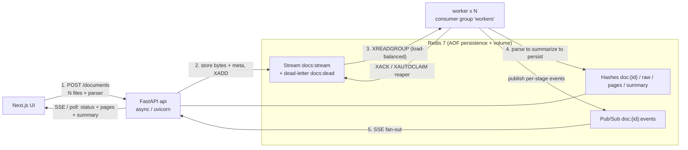

# Async PDF Processing — Implementation Plan

## Context

Greenfield repo (`summer`, empty git repo). We build an **async document-processing service**:
users upload one or more PDFs, choose a parser, and the backend asynchronously parses
each file to per-page Markdown and produces one summary per file. Results appear in the UI
in real time.

The brief's hard requirements: **Python 3.12+ / FastAPI**, **Redis 7+ with Streams as the
queue**, **PyPDF** (simple) and **Gemini `gemini-3.1-flash-lite`** (Markdown parse +
summary), **GPT-5 Mini OCR** as a nice-to-have, **Docker Compose**, minimal **Next.js** UI.

The reviewer explicitly emphasized three things beyond the happy path, which drive the design:
1. **Concurrency** — serve many upload/status requests and process many docs in parallel.
2. **Idempotency** — the same request must not duplicate work or results.
3. **Resumability** — if a worker/session dies mid-processing, work continues by **file or by id**.

Decisions (confirmed with user): **mock fallback** when API keys absent (app always boots &
demos; real mode when `GEMINI_API_KEY`/`OPENAI_API_KEY` set); **minimal Next.js** UI;
**SSE + polling fallback** for live updates; **hard 20 MB per-file upload cap** (aligned to
Gemini's inline limit) plus a **page-count cutoff** for what Gemini can't process, with a
dedicated ADR; **API-key auth with per-principal rate limits** (daily quota, max concurrent,
burst).

**Docs:** this plan is published to `docs/plan.md` and the size-limit ADR to
`docs/adr/ADR-0001-upload-size-limit.md` (created at execution — plan mode only permits editing
the plan file; both are embedded here).

---

## Architecture

Three app services + Redis, all in Docker Compose. API and workers share one Python package.

**Components & data flow** (Mermaid — renders natively on GitHub / most Markdown viewers)



1. Browser uploads files + chosen parser to the **api**.
2. api stores raw bytes + metadata and `XADD`s one job per file onto `docs:stream`.
3. Each **worker** (consumer group `workers`) pulls jobs via `XREADGROUP`, load-balanced.
4. Worker runs parse → summarize, persisting results and publishing events per stage, then `XACK`s.
5. Browser receives live updates over **SSE** (Redis Pub/Sub fan-out) with **polling** fallback.

Services: **api** (uvicorn, async), **worker** (`--scale worker=N`), **redis:7**, **frontend**.

### Request flow
1. `POST /documents` (multipart, N files + `parser`). API computes `content_hash =
   sha256(bytes)` per file, derives `doc_id = sha256(content_hash + parser)[:16]`
   (**deterministic → idempotent**), stores raw bytes + metadata, `XADD`s a job, returns
   `batch_id` + list of `doc_id`s immediately. Heavy work never runs in the request.
2. Worker in consumer group `workers` `XREADGROUP`s a job, runs the pipeline, writes
   results + publishes events, `XACK`s on terminal state.
3. Client watches via `GET /documents/{id}/events` (SSE) and/or `GET /documents/{id}` (poll).

---

## Idempotency & Resumability (the core)

**Deterministic ids.** `doc_id` derives from content hash + parser, so re-uploading the same
file+parser yields the same id. On upload, `SET idem:{doc_id} 1 NX`: if it already exists,
we **do not re-enqueue** — we return the existing id and its current state. Same file →
same result, no duplicate processing.

**Per-document state machine**, persisted in `doc:{id}` hash:
`queued → parsing → parsed → summarizing → done` (and `failed`). Each completed stage and its
intermediate output (per-page markdown, summary) are written to Redis **as they complete**, not
only at the end.

**Resume by id.** Worker, on picking up a job, reads current `status`/`stage` and **skips
already-completed stages** (e.g. parse done but summary failed → re-summarize only; never
re-call the paid parser). `done` → `XACK` + skip. So reprocessing is cheap and correct.

**Resume after crash (by file).** Redis Streams keep unacked entries in the consumer group's
PEL. A periodic **reaper** (`XAUTOCLAIM`, idle > threshold) reclaims entries orphaned by a
dead worker; because stages/intermediate results are persisted, the reclaiming worker
continues from the last good stage. A per-entry **delivery count** cap (via `XPENDING`) sends
poison messages to a dead-letter stream `docs:dead` + marks the doc `failed`.

**Resume a dropped client session.** Reconnecting SSE first emits the current snapshot from
`doc:{id}`, then live deltas — no lost updates. Polling works identically. Either way the
client recovers full state from `doc_id` alone.

**Concurrency.** API handlers are async (non-blocking Redis via `redis.asyncio`). Multiple
worker containers in one consumer group load-balance stream entries → true parallel doc
processing; scale with `docker compose up --scale worker=N`. Status transitions use atomic
Redis ops / a small Lua guard so two workers never double-advance one doc.

---

## Redis keyspace

| Key | Type | Purpose |
|---|---|---|
| `docs:stream` | stream | job queue; entry `{doc_id, parser}` |
| `docs:dead` | stream | dead-letter after max retries |
| group `workers` | — | consumer group on `docs:stream` |
| `idem:{doc_id}` | string (NX) | dedup guard |
| `doc:{id}` | hash | status, stage, parser, filename, content_hash, batch_id, page_count, error, timestamps |
| `doc:{id}:raw` | string | PDF bytes (TTL, e.g. 24h) |
| `doc:{id}:pages` | hash | page_no → markdown (written incrementally) |
| `doc:{id}:summary` | string | file summary |
| `doc:{id}:events` | pub/sub channel | SSE fan-out of state changes |
| `batch:{id}` | set | doc_ids of one upload |
| `apikey:{key}` | hash | principal + per-key limit overrides (optional; else from config) |
| `ratelimit:day:{principal}:{YYYYMMDD}` | string (EXPIRE) | daily call quota counter |
| `inflight:{principal}` | zset | in-flight doc_ids (score=enqueue ts) → concurrency cap |
| `ratelimit:burst:{principal}` | string (EXPIRE) | short-window burst counter |

Each `doc:{id}` also records its owning `principal` so status/SSE reads are ownership-scoped.

---

## Authorization & rate limiting

Every API call is authenticated and metered **per principal** (per API key). All counters live in
Redis, so limits are enforced consistently across multiple `api` replicas.

**Authentication.** Static API keys (Bearer token / `X-API-Key` header) mapped to a `principal`
(user id). Keys + per-key overrides seeded from config/env (and/or `apikey:{key}` hash in Redis);
easy to demo, no external IdP. Missing/invalid key → **401**. Auth is a FastAPI dependency applied
to all mutating routes; read-only status/SSE for a known `doc_id` also require a valid key.

**Three independent limits, all per principal (429 + `Retry-After` when exceeded):**
1. **Daily call quota** — fixed calendar-day window. `INCR ratelimit:day:{principal}:{YYYYMMDD}`
   with `EXPIRE` to end of day (UTC). Over `DAILY_LIMIT` → 429. Atomic, cheap, self-expiring.
2. **Max concurrent processing** — cap in-flight documents per principal. Tracked as a Redis
   **ZSET `inflight:{principal}`** (member = `doc_id`, score = enqueue epoch). On accept: trim
   members older than a safety TTL (crash-leak protection), `ZCARD`; if ≥ `MAX_CONCURRENT` → 429;
   else `ZADD`. The worker **`ZREM`s on every terminal transition** (`done`/`failed`). A Lua script
   makes trim-check-add atomic so two parallel uploads can't both slip past the cap.
3. **Short-window burst limit** *(bonus, cheap)* — token-bucket / fixed-window per few seconds to
   smooth spikes (`RATE_PER_MIN`), independent of the daily quota.

**Why crash-safe:** the concurrency ZSET ages out stale entries by score, so a worker dying
mid-job never permanently "uses up" a slot — it ties straight into the resumability design (a
reclaimed job re-registers, a truly dead one expires). Daily counters self-expire via TTL.

Order per request: **auth (401) → burst (429) → daily quota (429) → concurrency (429) → accept**.

## Upload limits (20 MB cap + Gemini page cutoff)

We set a **hard 20 MB per-file cap** (`MAX_UPLOAD_BYTES`, default 20 MB). This is deliberately
aligned to **Gemini's ~20 MB inline-request limit**, so a valid upload always fits inline — we
**avoid the File API entirely** (no upload-then-reference, no 48 h retention juggling) and keep one
simple global limit for every parser. Uploads are streamed so we never buffer whole files.

**The streaming byte-count is the authoritative guard — the header is never trusted.**
`Content-Length` is only a cheap fast-path: if present and already > cap, reject immediately with
**413**. But even when the header claims a smaller size (or is absent/lying), we read the body in
chunks (e.g. 1 MB), counting bytes and hashing incrementally, and **stop reading / abort with 413
the instant the running count exceeds the cap** — we never read beyond `cap` bytes into memory and
never persist a partial oversized file.

**Page-count cutoff — reject what Gemini can't process.** Byte size isn't Gemini's only limit:
it also caps **pages per PDF** (consistently reported **≤ 1,000**). Even a small-byte PDF can
exceed this, so for the Gemini parser/summarizer we read `page_count` (cheap, via PyPDF) **before**
calling the API and **reject with 422 if > `GEMINI_MAX_PAGES` (default 1000)**, with an optional
**fall back to PyPDF** (degradation surfaced in the doc's `error`/status). GPT-5 Mini OCR
rasterizes per page, so the same page cutoff applies. PyPDF itself has no page limit.

- **Bounded memory in the pipeline:** parse **per page**, writing each page's markdown to Redis as
  it is produced, so worker memory is O(one page), not O(file).
- **Storage of raw bytes:** stored in Redis (`doc:{id}:raw`) with a TTL; the 20 MB cap keeps Redis
  memory small and predictable. Production path (object storage) is noted in the ADR, not built.

Provider numbers live in config (`MAX_UPLOAD_BYTES`, `GEMINI_MAX_PAGES`) and are tunable without
code changes.

Full rationale lives in `docs/adr/ADR-0001-upload-size-limit.md` (text below, written at execution).

### ADR-0001 — Cap PDF uploads at 20 MB (+ Gemini page cutoff) and store raw bytes in Redis

**Status:** Accepted · **Date:** 2026-11-15

**Context.** The service accepts arbitrary user PDFs, which can be very large. Unbounded uploads
threaten four things: (a) **API memory** if the body is buffered whole; (b) **Redis memory**,
since we stage raw bytes and per-page markdown there; (c) **worker latency/cost**; and
(d) **downstream provider limits** — research into Gemini's document processing shows an inline
request size ceiling around **~20 MB** (above which the File API is required) **and** a page
ceiling of **≤ 1,000 pages per PDF**, independent of bytes. A `Content-Length` header is
attacker-controllable and cannot be trusted. We want the simplest bound that keeps every parser
within Gemini's inline limit and the system stable/demoable within the assessment scope.

**Decision.**
1. Enforce a **hard ingest cap of 20 MB per file** (`MAX_UPLOAD_BYTES`, default 20971520),
   deliberately aligned to **Gemini's ~20 MB inline-request limit** so every accepted upload fits
   inline and we **avoid the File API** (and its upload step + 48 h retention). One global cap for
   all parsers. The header is only a fast-path (`Content-Length` already over cap → immediate 413);
   the **authoritative check is the streaming byte count**: read the body in chunks, never buffer
   more than the cap, and **abort with 413 the moment the real count exceeds it** — even if the
   header claimed less. No partial oversized file is persisted.
2. **Page-count cutoff:** Gemini also caps pages (~1000), independent of bytes. The Gemini path
   reads `page_count` (PyPDF) **before** the API call and **rejects with 422 if >
   `GEMINI_MAX_PAGES` (default 1000)**, optionally falling back to PyPDF. PyPDF has no page limit.
3. **Stream** the upload and **process per page**, keeping API and worker memory bounded.
4. Store raw bytes in **Redis with a TTL**; the 20 MB cap keeps the Redis footprint small.

**Consequences.**
- *Positive:* one simple limit, no File API complexity, predictable/small memory, early rejection
  of oversized uploads, honest handling of Gemini's page limit, simple to test. Per-page
  persistence also powers resumability (stage-skip).
- *Negative / accepted trade-offs:* 20 MB rejects some legitimately large PDFs that PyPDF alone
  could handle — accepted for a uniform, Gemini-safe limit. Raw bytes in Redis is convenient but
  not how we'd run at scale.
- *Future work (out of scope):* object storage (S3/MinIO) + File API for a higher cap; chunked/
  resumable upload (tus); virus scanning; split >1000-page PDFs into sub-jobs; tier-dependent caps.

**Alternatives considered.** No limit (rejected: OOM / provider errors); 100 MB with a File-API
path for Gemini (rejected: extra complexity and retention handling for little assessment value);
per-parser byte caps (rejected: a file succeeding on one parser but 413-ing on another is
confusing). A single 20 MB cap matched to Gemini's inline limit is the simplest correct choice.

**Sources (Gemini limits, verify against official docs before prod):**
[Gemini document processing (ai.google.dev)](https://ai.google.dev/gemini-api/docs/document-processing?hl=en) ·
[Firebase/Vertex input file requirements](https://firebase.google.com/docs/vertex-ai/input-file-requirements) ·
[CometAPI: Gemini file sizes & input methods](https://www.cometapi.com/gemini-api-what-file-sizes--input-methods-are-supported-now/)

---

## Backend layout (`backend/`)

```
app/
  main.py            FastAPI app, lifespan (redis pool, ensure consumer group)
  config.py          pydantic-settings (REDIS_URL, GEMINI_API_KEY, OPENAI_API_KEY, model ids,
                     MAX_UPLOAD_BYTES (20 MB), GEMINI_MAX_PAGES (1000),
                     API_KEYS, DAILY_LIMIT, MAX_CONCURRENT, RATE_PER_MIN, worker tunables)
  models.py          Pydantic: ParserType enum, DocStatus, responses, Principal
  auth.py            API-key dependency -> Principal; 401 on missing/invalid
  ratelimit.py       Redis counters: daily quota, concurrency ZSET (Lua), burst bucket; 429 + Retry-After
  api/documents.py   POST /documents, GET /documents/{id}, GET /documents/{id}/events (SSE), GET /batches/{id}
                     (all behind auth + rate-limit dependencies; ownership-scoped by principal)
  store.py           Redis repository: all keyspace ops, atomic stage transitions, idempotency,
                     events, concurrency-slot release (ZREM inflight) on terminal state
  queue.py           Streams helpers: enqueue, consumer-group read, ack, XAUTOCLAIM reaper, dead-letter
  parsers/
    base.py          Parser protocol -> (pages: list[str])
    pypdf_parser.py  PyPDF text per page
    gemini_parser.py Gemini PDF->markdown per page (mock fallback)
    openai_parser.py GPT-5 Mini OCR (render page->image->OCR) [nice-to-have; mock fallback]
    registry.py      ParserType -> parser; easy to extend
  summarizer.py      Gemini summary of full markdown (mock fallback)
  worker.py          consumer loop: claim -> pipeline w/ stage-skip -> persist -> publish -> ack; + reaper task
  pipeline.py        orchestrates parse->summarize with resume-from-stage logic
tests/               pytest: idempotency, stage-skip/resume, parser registry, queue ack/reclaim (fakeredis)
pyproject.toml
Dockerfile
```

**Key reuse / libraries:** `redis` (asyncio) for pool + streams + pubsub; `pypdf` for text;
`google-genai` for Gemini; `openai` for GPT-5 Mini; `pymupdf`(fitz) or `pdf2image` to
rasterize pages for OCR; `fastapi`/`uvicorn`; `pydantic-settings`. Parsers behind a common
`Parser` protocol + `registry` so adding methods is a one-file change (strategy pattern).

**Mock fallback:** each AI client checks for its key at construction; absent → a deterministic
mock (parser echoes PyPDF text wrapped as markdown; summarizer returns a templated first-N-words
summary). App boots and the full pipeline/UI demo works with zero keys.

---

## Frontend (`frontend/`, minimal Next.js + TS)

Single page: multi-file picker + parser `<select>` → `POST /documents` → render a card per
`doc_id`. Each card opens an SSE connection (`EventSource`) to show status, per-page markdown
(rendered), and the summary as they arrive; polling fallback if SSE drops. `.env` →
`NEXT_PUBLIC_API_BASE`.

---

## Redis persistence (durability of the queue & state)

Our entire resumability story assumes Redis does **not** lose the stream, the consumer-group
PEL, or `doc:{id}` state across a restart — so we enable **on-disk persistence** explicitly and
do not rely on defaults:

- **AOF on:** `--appendonly yes --appendfsync everysec` (fsync ~once/sec → at most ~1s of writes
  lost on crash, good throughput). AOF persists stream entries **and** consumer-group / PEL
  metadata, so in-flight jobs survive a Redis restart and the reaper/stage-skip logic can resume.
- **RDB snapshots** kept as a secondary point-in-time backup (default `save` rules are fine).
- **Durable volume:** mount a named volume at `/data` in Compose so AOF/RDB files outlive the
  container. Without this, a `docker compose down` wipes everything — the common gotcha.
- **Verification:** after processing, `docker compose restart redis` (or `down`/`up` with the
  volume) → `XINFO STREAM docs:stream` and `doc:{id}` state are intact; in-flight docs resume.

Note: data in `doc:{id}:raw` carries a TTL; TTLs are also persisted by AOF/RDB, so expirations
survive restarts as expected.

## Docker Compose

`redis:7` with `command: redis-server --appendonly yes --appendfsync everysec` and a named
volume on `/data`; `api` (uvicorn, depends_on redis, healthcheck); `worker` (same image,
`command: python -m app.worker`, scalable via `--scale worker=N`); `frontend` (Next dev/prod).
`.env.example` documents `GEMINI_API_KEY`, `OPENAI_API_KEY`, `REDIS_URL`, `MAX_UPLOAD_BYTES`,
`API_KEYS`, `DAILY_LIMIT`, `MAX_CONCURRENT`, `RATE_PER_MIN`, model ids.
`GEMINI_MODEL_ID=gemini-3.1-flash-lite`.

---

## Build order (by brief priority)

1. Scaffold backend, config, Redis pool, Compose (api + redis booting).
2. `POST /documents` + `GET /documents/{id}` + keyspace + **idempotency** (deterministic id, NX)
   + **streaming 20 MB cap** (chunked read, incremental hash, 413) + Gemini page cutoff (422).
2b. **Auth (API key → principal, 401)** + **rate limits** (daily quota, concurrency ZSET + Lua,
   burst) → 429; ownership-scope reads by principal.
3. **Redis Streams** enqueue + worker consumer group + ack + PyPDF parser → end-to-end async.
4. **Resumability:** persisted stage machine + stage-skip + `XAUTOCLAIM` reaper + dead-letter.
5. Gemini summarizer (+ mock fallback).
6. Gemini markdown parser (+ mock fallback).
7. SSE endpoint + pub/sub wiring.
8. GPT-5 Mini OCR parser (nice-to-have).
9. Minimal Next.js UI.
10. Tests, README (curl demo + sample public PDF), `docs/plan.md` + `docs/adr/ADR-0001-*.md`, polish.

Backend (1–7) is the must-have; 8–9 are nice-to-have; graceful degradation keeps everything
demoable without keys.

---

## Verification

- `docker compose up --build` → api on :8000, redis on :6379, frontend on :3000.
- **Idempotent upload:** `POST` same PDF+parser twice → identical `doc_id`, one set of results,
  no second stream entry (`XLEN docs:stream`).
- **Async + concurrency:** upload several PDFs; `--scale worker=3`; confirm parallel progress
  via per-doc status.
- **Resume by crash:** kill a worker mid-parse (`docker kill`); reaper reclaims; doc reaches
  `done` without re-running completed stages (assert via logs/stage field).
- **Redis persistence:** `docker compose restart redis` after an upload → `XINFO STREAM
  docs:stream` + `doc:{id}` survive; AOF file present in the mounted volume.
- **Resume by id/session:** drop & reopen SSE (or poll) on an in-flight `doc_id` → full state
  recovered.
- **Mock vs real:** runs end-to-end with no keys (mock); set `GEMINI_API_KEY` → real markdown +
  summary.
- **Size cap:** upload a > 20 MB file → **413**, no job enqueued; a ~10 MB file still processes.
  A lying `Content-Length` (header < cap, body > cap) is still rejected mid-stream with 413.
- **Gemini page limit:** a > 1000-page PDF with the Gemini parser → **422** (or PyPDF fallback),
  while PyPDF accepts it.
- **Auth:** no/invalid key → **401**; valid key processes normally; reads are scoped to the owner.
- **Rate limits:** exceed `MAX_CONCURRENT` simultaneous docs → **429** (concurrency frees as docs
  finish); exceed `DAILY_LIMIT` calls → **429** with `Retry-After`; counters visible in Redis.
- `pytest` green (idempotency, stage-skip resume, registry, queue ack/reclaim, 413 size cap via fakeredis).
- `docs/plan.md` and `docs/adr/ADR-0001-upload-size-limit.md` present.
- README: curl commands against a sample public PDF; screenshot or UI walkthrough.
